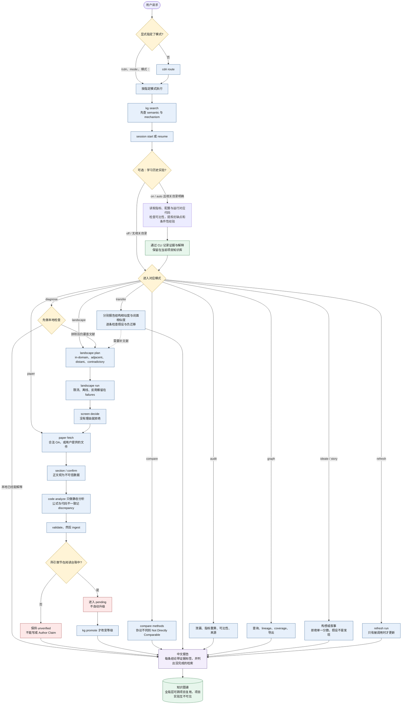

# Cross-Domain Research Intelligence (CDRI)

面向 **Claude Code / Codex CLI / Cursor / OpenCode** 的科研情报 Agent Skill：文献调研（四通道检索）、论文方法深读与代码对照、
跨学科机制迁移、实验失败诊断、数据与指标审计、研究构想与科学叙事，并把读过的内容沉淀为**带证据等级的知识图谱**供跨项目复用。
也可以在开始新研究前，选择读取指定文件夹中的历史实验，从指标、配置和模型代码中总结优缺点与可复用知识；实验及其经验保存在当前项目知识库。
对本次调研中判断创新性突出的论文，还会分析其科学问题、关键洞察、证据链和边界条件，将“性能之外的科学贡献”存成可检索的理解卡，用于后续研究假设与论文叙事。

CDRI 的核心原则：**不伪造、不越级、不隐瞒失败**。每条结论带证据标签（Verified Fact / Author Claim / Agent Interpretation /
Hypothesis / Unverified）；证据等级由来源决定、不会自动升级；检索失败、限流、全文缺失都会显式写入结果与报告。

- Skill 本体：[`skills/cdri/`](skills/cdri/)（`SKILL.md` + `references/` + `scripts/` + `assets/`）
- 设计文档：[`docs/01-reference-analysis.md`](docs/01-reference-analysis.md)、[`docs/02-architecture.md`](docs/02-architecture.md)
- 测试报告：[`docs/03-test-report.md`](docs/03-test-report.md)（含真实 API 冒烟测试与“已实现 / 未实现”清单）
- 使用演示（真实命令输出）：[`docs/04-usage-demo.md`](docs/04-usage-demo.md)
- CLI 全量参考：[`skills/cdri/references/cli.md`](skills/cdri/references/cli.md)

## Skill 流程

Agent 负责规划、阅读和判断。CLI 是写入知识库的唯一路径。用户用 `/cdri`、`mode:` 或 `模式：` 点名的模式优先于 `cdri route`。



实线是主路径，虚线是可选分支。诊断在本地就能解释时不检索文献。检索失败、全文缺失和未读章节会停在报告里，不会被写成已核实结论。

---

## 1. 环境要求

- Python ≥ 3.9（仅标准库；SQLite 需支持 FTS5，CPython 官方发行版均支持）
- git（代码-方法映射需要固定 commit）
- 网络（检索时）；Agent 沙箱若禁网，CLI 会把每个源标记为 `offline`/`error`，不会假装检索成功
- 可选：`pymupdf4llm` 或 `pymupdf`（PDF 解析质量更好）、`pypdf`、`sentence-transformers`（本地嵌入检索）

```bash
pip install pymupdf4llm          # 可选，推荐
pip install sentence-transformers  # 可选；不装时语义检索自动退化为 TF-IDF 并注明
```

## 2. 安装 / 卸载

```bash
git clone <this repo> cdri && cd cdri

python install.py install --platform all            # 复制到所有平台的用户级 skills 目录
python install.py install --platform claude         # 只装 Claude Code: ~/.claude/skills/cdri
python install.py install --platform codex --agents-md   # Codex: ~/.codex/skills/cdri 与 ~/.agents/skills/cdri，并在 ~/.codex/AGENTS.md 写入指针块
python install.py install --platform cursor --scope project --project-dir . --cursor-rule   # Cursor 项目级 + .cursor/rules/cdri.mdc
python install.py install --platform opencode       # ~/.config/opencode/skill/cdri
python install.py install --platform claude --link  # 开发模式：symlink（Windows 失败时尝试 junction，再退回复制）
python install.py install --dest /custom/skills     # 自定义目录（工具版本使用不同发现路径时）

python install.py status                             # 查看安装位置
python install.py uninstall --platform all           # 只删除本安装器创建的目录 / AGENTS.md 块 / Cursor 规则
python install.py uninstall --platform all --purge-data --yes   # 同时删除 $CDRI_HOME（全局知识库！）
```

安全设计：已存在但非 CDRI 安装的 `cdri` 目录不会被覆盖（需 `--force`）；卸载默认保留知识库；`--purge-data` 必须加 `--yes`；
AGENTS.md 只增删 `<!-- CDRI:BEGIN -->…<!-- CDRI:END -->` 之间的内容。安装后自动运行 `config check`。

## 3. 配置与 API Key

所有 Key 都是**可选**的，只通过环境变量提供（`config set` 拒绝写入密钥到配置文件）。

| 环境变量 | 作用 | 不设置时 |
|---|---|---|
| `CDRI_MAILTO` | 联系邮箱：OpenAlex/Crossref polite pool、Unpaywall | 可用但更易限流；Unpaywall 步骤跳过并在 `tried` 中注明 |
| `OPENALEX_EMAIL` / `UNPAYWALL_EMAIL` | 覆盖上面的邮箱 | 使用 `CDRI_MAILTO` |
| `S2_API_KEY` | Semantic Scholar | **无 Key 时常见 HTTP 429**，作为 `rate_limited` 失败报告 |
| `NCBI_API_KEY` | PubMed E-utilities 提高速率 | 3 req/s |
| `GITHUB_TOKEN` | GitHub API（代码定位） | 60 req/h |
| `CDRI_HOME` | 全局知识库、缓存位置 | `~/.cdri` |
| `CDRI_PROJECT` | 项目目录（项目层 `.cdri/`） | 当前目录；也可用全局参数 `--project PATH` |
| `CDRI_OFFLINE=1` | 只用缓存，禁止联网 | — |
| `CDRI_EMBEDDINGS=1`、`CDRI_EMBED_MODEL` | 启用本地嵌入检索（模型在本地运行，不上传数据） | TF-IDF |
| `CDRI_TODAY` | 固定“今天”（测试 / 复现实验时间窗） | 系统日期 |

```bash
python skills/cdri/scripts/cdri.py config show            # 当前配置（密钥只显示 set / not set）
python skills/cdri/scripts/cdri.py config check --ping    # 依赖、FTS5、git、各 API 连通性
python skills/cdri/scripts/cdri.py config set window_months 18   # 可配置：window_months, core_years, default_intensity
```

## 4. 在 Agent 中使用

安装后直接用自然语言提问即可，Skill 描述会触发自动加载；也可以显式指定模式（显式模式永远优先于自动路由）：

```text
调研最新的 TF–DNA binding specificity prediction，重点关注 unseen transcription factor generalization。
/cdri diagnose 某个新模型训练正常，但在未见过的测试对象上泛化很差，甚至低于简单基线。
mode: transfer 研究空间细胞扰动预测，并主动从其他学科寻找可以迁移的方法。
模式：story 模型性能提升有限，但我们发现了测量噪声上限、训练目标的局限和重要的机制反例。
```

可选的历史实验学习适用于各模式，不改变已选模式，也不要求每次执行：

```text
先学习 D:/Research/experiments 中已有实验的指标和模型代码，总结各模型优缺点、失败原因和可复用知识，再提出下一步方案。
/cdri diagnose 泛化差；learn_history: on；history_root: D:/Research/runs；重点看 val_spearman 和未见实体测试集。
这次跳过历史实验，learn_history: off，只调研相关文献。
```

`learn_history: auto|on|off`、`history_root`、`include`、`exclude` 和 `focus_metrics` 是 **Agent 请求选项，不是 CLI 参数**。
默认 `auto`：当前问题相关且项目内实验目录明确时读取，否则跳过；`on` 显式启用，`off` 显式跳过。
Agent 读取日志、结果、配置和代码快照，核对指标口径与实验所用代码，保留失败与无效结果；知识点包含证据、适用条件、反例和待验证实验。
代码只做静态阅读，不自动训练；旧实验缺少代码快照时会标记实现未核实，协议不同或未知的分数不会混排。
具体流程见 [`experiment-history.md`](skills/cdri/references/experiment-history.md)。

对于重点创新论文，Agent 会进一步提问：**如果去掉 SOTA 提升，这篇论文还有什么科学贡献？哪项证据让它的核心论点成立？**
分析沿“问题 → 缺口 → 洞察 → 方法 → 关键证据 → 科学意义 → 边界”展开，同时检查替代解释与不足。
这些内容写入可选的 `G_research_story`，通过原有 `paper validate` / `paper ingest` 存为关联论文与方法的知识卡，
可用 `kg search --mode semantic` 检索，并在 `report paper` 中查看。后续提出 research thesis 时，按问题、机制和证据设计检索这些卡片，
核对适用条件并生成可证伪假设。总结属于 Agent Interpretation，原文未读或证据不全时保持 unverified；不能据发表结果反推实际录用原因。
此处 RAG 指检索已积累的理解卡来辅助推理；默认使用现有本地 TF-IDF 检索，可选本地 embedding，不涉及模型微调。
流程与字段见 [`research-story.md`](skills/cdri/references/research-story.md)。

```text
调研这个方向，对你在本次已读论文中认为最有创新性的工作，分析它如何建立有说服力的科学故事、性能之外贡献了什么，并沉淀成可检索知识。
为当前课题提出 research thesis 前，检索已有研究故事理解卡，说明可借鉴的洞察、适用边界，以及我们仍缺少的关键实验。
```

| 模式 | 用途 |
|---|---|
| `landscape` | 四通道检索（in-domain / adjacent / distant / contradictory）、动态时间窗、筛选分级、覆盖报告 |
| `paper` | 合法 OA 全文级联、章节阅读台账、sentinel 完整阅读确认、Paper Card、公式-代码对照 |
| `compare` | 方法签名对比、协议可比性矩阵（不可比数字不排序） |
| `transfer` | 问题结构匹配（结构相似度 vs 词面相似度）、假设适用性检查、负迁移风险 |
| `diagnose` | 日志 / 预测分布分析、先本地后文献的分诊、诊断工作表、冻结决策 |
| `audit` | 分组泄漏、指标重算（pooled vs grouped）、可比性、来源核查 |
| `graph` | 知识图谱查询（keyword / semantic / mechanism / chunks）、溯源、覆盖与缺口、导出 |
| `ideate` | 研究构想卡（多维度等级，拒绝单一分数）、来源追溯 |
| `story` | 基于实验与反例的科学叙事骨架与检查 |
| `refresh` | 显式触发的增量更新（新论文、预印本→正式发表状态变化） |

Agent 会调用 CLI：`python <skill>/scripts/cdri.py <command>`（下文记作 `$CDRI`）。

## 5. 命令示例

```bash
CDRI="python skills/cdri/scripts/cdri.py"

$CDRI route "研究空间细胞扰动预测，并主动从其他学科寻找可以迁移的方法。"   # 路由结果 + 建议命令
$CDRI project init --name tfbind --goal "unseen-TF generalization"

# landscape
$CDRI landscape plan "TF-DNA binding specificity prediction" --abstraction "predict interactions with unseen entities" --out plan.json
$CDRI landscape run --plan plan.json --run-id tf1
$CDRI screen suggest --run tf1 --tier focused
$CDRI screen decide paper:doi:10.1038/nbt.3300 --run tf1 --tier deep --reason "foundational CNN baseline"
$CDRI report landscape --run tf1 --out auto

# paper
$CDRI paper verify 10.1038/nbt.3300 --title "Predicting the sequence specificities of DNA- and RNA-binding proteins by deep learning"
$CDRI paper fetch arXiv:1706.03762 --plan          # 或 --file paper.pdf（合法获得的本地文件）
$CDRI paper section arXiv:1706.03762 methods       # 读章节并写入阅读台账
$CDRI paper confirm arXiv:1706.03762 <sentinel>    # 确认读完全文
$CDRI paper card-template > card.json && $CDRI paper validate card.json && $CDRI paper ingest card.json
$CDRI code analyze ./repo && $CDRI code show ./repo model.py --symbol Model.forward

# transfer / diagnose / audit
$CDRI project problem problem.json && $CDRI transfer scan && $CDRI transfer check method:<id>
$CDRI diagnose log train_log.csv --metric-col val_spearman --baseline 0.35
$CDRI diagnose triage "generalizes poorly to unseen entities" --obs obs.json
$CDRI audit leakage split.csv --split split --group family
$CDRI audit metric preds.csv --metric spearman --true true --pred pred --group tf

# graph / refresh / session
$CDRI kg search "optimal transport" --mode mechanism
$CDRI kg pending && $CDRI kg promote <id> --status author_claim --source-type paper_fulltext --ref <paper> --location "3 Results"
$CDRI graph export --view transfer --format html --out graph.html
$CDRI refresh add "TF-DNA binding specificity prediction" --variant "unseen transcription factor" && $CDRI refresh list
$CDRI refresh run <watch-id>
$CDRI session start landscape "TF binding" && $CDRI session resume
```

完整演示（含每一步真实输出）见 [`docs/04-usage-demo.md`](docs/04-usage-demo.md)，由 `python tools/run_demo.py` 离线重新生成。

## 6. 数据位置

| 层 | 位置 | 内容 |
|---|---|---|
| 全局知识库 | `$CDRI_HOME/global.sqlite` | 论文、方法、机制、领域、作者主张、阅读台账、全文索引（FTS5） |
| 缓存 | `$CDRI_HOME/cache/` | HTTP 响应、解析后的全文（带 UNTRUSTED 头与 sentinel） |
| 项目知识库 | `<project>/.cdri/project.sqlite` | 项目问题、实验、诊断、迁移假设、构想；**不会**进入全局层 |
| 项目文件 | `<project>/.cdri/{runs,sessions,exports,...}` | 检索日志、会话、报告 |

隐私：检索查询会经过隐私闸门（疑似本地路径、访问令牌、长十六进制串、邮箱地址、超过 300 字符的粘贴文本会被拦截，需
`--allow-sensitive`；这是模式匹配，不能识别所有未公开信息）；
本地代码、数据、实验结果不会上传；嵌入模型在本地运行。

## 7. 测试

```bash
pip install pytest
python -m pytest tests           # 全部离线：合成 fixture + 本地 git 仓库
python tools/check_command_refs.py # 检查文档中引用的每条 cdri 命令都存在
python tools/run_demo.py         # 重新生成 docs/04-usage-demo.md
python tools/gen_cli_reference.py  # 重新生成 references/cli.md
```

fixture 全部为合成数据（标题带 `[SYNTHETIC FIXTURE]`，DOI 使用 `10.5555/cdri.fx.*`），不冒充真实文献。

## 8. 能力边界（摘要）

详见 [`docs/03-test-report.md`](docs/03-test-report.md) 第 4 节。要点：

- **不会后台运行**：Skill 只在 Agent 调用时工作；`refresh` 必须显式触发（可配合外部定时任务）。
- Semantic Scholar 可能返回 429（未配置 `S2_API_KEY` 时使用共享匿名池），dblp 可能返回反爬页面，报告为 `blocked`。
  同一轮中限流重试耗尽或遇到反爬后，会暂停该源，后续查询记录为 `skipped_source`，其他源继续；下轮可重新尝试。
  总结区分 `complete / partial / failed / not_run`，列出限定/排除的来源及恢复建议；`empty` 是成功执行但无匹配结果。
  `config check --ping` 会验证 API 返回的 JSON/XML，并为 Semantic Scholar 携带配置的 Key，避免把 HTML 挑战页判为正常。
- 只获取合法开放获取全文（arXiv HTML/PDF、PMC、Europe PMC、Unpaywall OA 链接）；不抓取出版商付费页面。
- PDF 无版面模型时章节与公式识别较弱（会给出警告）；HTML 全文质量最好。
- 模式路由、代码角色识别、问题结构匹配都是启发式的，结果是“建议”，由 Agent 复核。
- 报告中的分析性段落（`<!-- AGENT: ... -->`）由 Agent 在阅读后填写；CLI 只生成有证据支撑的结构化部分。

## 9. 目录结构

```text
install.py                 安装 / 卸载
skills/cdri/SKILL.md       Skill 入口（规则、路由、工作流、输出契约）
skills/cdri/references/    按需加载的详细说明（workflows / epistemics / retrieval / paper-card / transfer / diagnosis / integrity-audit / platforms / cli）
skills/cdri/assets/        本体：机制、问题结构、学科路由、指标、诊断分类；模板
skills/cdri/scripts/       cdri.py 与 cdri_lib（config, http, ids, kg, retrieval, paper, codemap, transfer, diagnose, audit, insight, report, refresh, session, router, cli）
tests/                     单元 / 集成 / 场景 A–E / 安装器测试与合成 fixture
tools/                     CLI 参考生成、演示生成
docs/                      参考分析、架构、测试报告、演示
```

## 许可证

MIT，见 [`LICENSE`](LICENSE)。参考项目致谢见 [`THIRD_PARTY_NOTICES.md`](THIRD_PARTY_NOTICES.md)。
